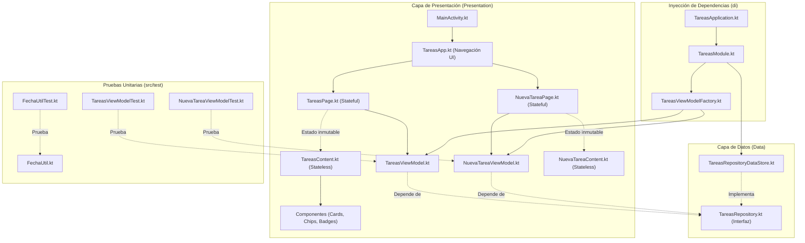
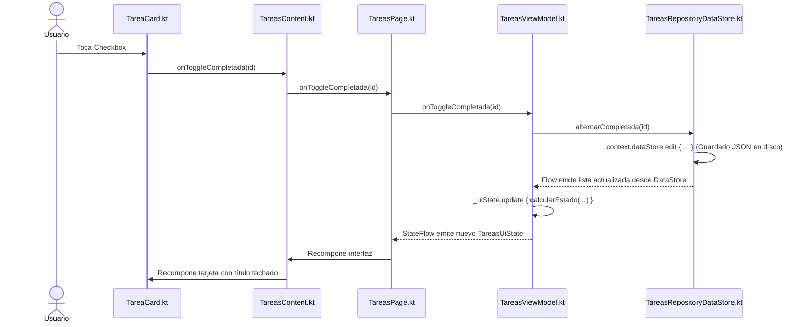

# Guía Maestra para la Defensa Oral del Proyecto "Tareas Escolares"

> **Materia:** Desarrollo de Aplicaciones Móviles  
> **Estudiante:** 4to Semestre de Ingeniería en TI  
> **Stack:** Android Nativo, Kotlin, Jetpack Compose, Material 3, MVVM, UDF, Patrón Repository, Jetpack Preferences DataStore, Corrutinas (`Dispatchers.IO`), Inyección de Dependencias Manual, Pruebas Unitarias (`kotlinx-coroutines-test`).

---

## 1. Resumen Ejecutivo del Proyecto

**Tareas Escolares** es una aplicación móvil nativa Android diseñada para que los estudiantes organicen sus actividades académicas de forma ágil, intuitiva y persistente. Cada tarea cuenta con:
* **Identificador único (`id`):** Asignado automáticamente de forma incremental.
* **Título:** Nombre de la actividad (obligatorio, máx. 60 caracteres).
* **Materia:** Asignatura correspondiente (obligatoria, máx. 40 caracteres).
* **Nivel de Prioridad:** Enum con tres valores (`ALTA`, `MEDIA`, `BAJA`).
* **Fecha Límite:** Cadena en formato estricto `dd/MM/yyyy` que no puede ser anterior al día actual.
* **Estado:** Booleano que indica si la actividad está pendiente (`false`) o completada (`true`).

### Funcionalidades y Novedades del Proyecto:
1. **Persistencia Real en Disco:** Integración con Jetpack Preferences DataStore y serialización JSON nativa (`org.json`), garantizando que los datos sobrevivan al cierre o reinicio de la aplicación.
2. **Listado Ordenado Automáticamente:** Cronológico por fecha límite (ascendente) con desempate jerárquico por nivel de prioridad (`ALTA > MEDIA > BAJA`).
3. **Filtrado Combinado en Tiempo Real:** Filtro de estado (`TODAS`, `PENDIENTES`, `COMPLETADAS`) combinado simultáneamente con filtro por prioridad.
4. **Indicador de Progreso Dinámico:** Muestra el porcentaje y número de tareas finalizadas sobre el total global almacenado.
5. **Formulario con Validaciones en Caliente:** Previene guardar datos inválidos o fechas pasadas emitiendo errores desacoplados (`@StringRes`).
6. **Estrategia de Pruebas Unitarias:** Cobertura de pruebas automatizadas para utilidades, validaciones y lógica de presentación de los ViewModels con `FakeTareasRepository` y `StandardTestDispatcher`.

---

## 2. Arquitectura de Software y Patrones de Diseño

La aplicación sigue los principios de **Clean Architecture** estructurándose en dos capas principales: **Capa de Datos (Data)** y **Capa de Presentación (Presentation)**, desacopladas mediante una interfaz de repositorio y un contenedor de inyección de dependencias.



### Patrones Aplicados:
* **MVVM (Model - View - ViewModel):**
  * **Model:** `Tarea.kt`, `TareasRepository.kt` y `TareasRepositoryDataStore.kt`.
  * **View:** Composables stateless (`TareasContent.kt`, `NuevaTareaContent.kt` y componentes). Dibuja la UI y emite eventos hacia el ViewModel.
  * **ViewModel:** `TareasViewModel.kt` y `NuevaTareaViewModel.kt`. Alojan el estado inmutable (`StateFlow`) y orquestan la lógica.
* **UDF (Flujo Unidireccional de Datos):** El estado fluye en un solo sentido hacia la interfaz; los eventos de usuario ascienden mediante funciones lambda.
* **Patrón Repository:** Centraliza la fuente de datos tras una interfaz (`TareasRepository`), abstraendo si la persistencia es DataStore, memoria o base de datos.
* **Inversión de Dependencias (DIP):** Los ViewModels no instancian clases concretas de persistencia, sino que reciben la abstracción `TareasRepository` mediante `TareasViewModelFactory`.
* **State Hoisting:** Ningún componente hijo guarda variables mutables del dominio.
* **Separación Page vs. Content:** 
  * Las **Pages** son *stateful* (obtienen el ViewModel y observan flujos con `collectAsStateWithLifecycle`).
  * Los **Contents** son *stateless* (funciones puras e independientes de Android Context, ideales para Previews y testing).

---

## 3. Jerarquía y Estructura de Carpetas

Package base: `com.example.appinteractiva`

```text
com/example/appinteractiva/
├── MainActivity.kt                      -> Punto de entrada de la actividad (arranque sin lógica)
├── TareasApplication.kt                 -> Contenedor global de la app (Application subclass)
├── ui/theme/                            -> Sistema de diseño visual
│   ├── Color.kt                         -> Paleta de colores oficial y niveles de prioridad
│   ├── Theme.kt                         -> LightColorScheme y TareasEscolaresTheme
│   └── Type.kt                          -> Escala tipográfica Material 3
└── tareas/                              -> Módulo temático principal de tareas
    ├── data/
    │   ├── model/                       -> Clases del modelo de dominio
    │   │   ├── Tarea.kt                 -> Data class inmutable
    │   │   ├── Prioridad.kt             -> Enum (ALTA, MEDIA, BAJA)
    │   │   └── FiltroEstado.kt          -> Enum (TODAS, PENDIENTES, COMPLETADAS)
    │   └── repository/                  -> Capa de almacenamiento y persistencia
    │       ├── TareasRepository.kt      -> Interfaz (Contrato abstracto)
    │       ├── TareasRepositoryDataStore.kt -> Implementación persistente con Preferences DataStore + org.json
    │       └── TareasRepositoryEnMemoria.kt -> Implementación reactiva en memoria (útil para pruebas)
    ├── di/
    │   └── TareasModule.kt              -> Contenedor de inyección de dependencias manual
    ├── util/
    │   └── FechaUtil.kt                 -> Utilidad pura para validación y parseo estricto de fechas
    └── presentation/
        ├── navigation/
        │   ├── Pantalla.kt              -> Destinos de navegación (LISTA, FORMULARIO)
        │   └── TareasApp.kt             -> Enrutador raíz con rememberSaveable
        ├── screens/
        │   ├── TareasUiState.kt         -> Estado inmutable de la pantalla principal
        │   ├── FormularioUiState.kt     -> Estado inmutable del formulario
        │   ├── TareasContent.kt         -> UI sin estado de la lista
        │   ├── TareasPage.kt            -> UI con estado conectada a TareasViewModel
        │   ├── NuevaTareaContent.kt     -> UI sin estado del formulario
        │   └── NuevaTareaPage.kt        -> UI con estado conectada a NuevaTareaViewModel
        ├── viewmodels/
        │   ├── TareasViewModel.kt       -> Orquesta filtros, ordenamiento y porcentaje de avance
        │   ├── NuevaTareaViewModel.kt   -> Orquesta validaciones del formulario y creación
        │   └── TareasViewModelFactory.kt-> Fábrica que inyecta el repositorio a los ViewModels
        ├── components/                  -> Componentes atómicos reutilizables
        │   ├── ChipOpcion.kt            -> FilterChip parametrizado
        │   ├── PrioridadEtiqueta.kt     -> Extensión para vincular prioridad con strings.xml
        │   ├── PrioridadBadge.kt        -> Badge coloreado por nivel de prioridad
        │   ├── PrioridadChips.kt        -> Selector horizontal de prioridad
        │   ├── ProgresoCard.kt          -> Tarjeta con barra LinearProgressIndicator
        │   ├── FiltrosRow.kt            -> Fila doble de filtros (Estado + Prioridad)
        │   ├── TareaCard.kt             -> Tarjeta individual de tarea
        │   └── EstadoVacio.kt           -> Vista informativa cuando no hay tareas
        └── preview/
            └── DatosEjemplo.kt          -> Datos ficticios aislados para Previews en IDE

src/test/java/com/example/appinteractiva/  -> Módulo de Pruebas Unitarias
└── tareas/
    ├── util/
    │   └── FechaUtilTest.kt             -> Pruebas unitarias para validación de fechas
    └── presentation/viewmodels/
        ├── TareasViewModelTest.kt       -> Pruebas de orquestación, filtros y progreso
        └── NuevaTareaViewModelTest.kt   -> Pruebas de validación y creación en el formulario
```

---

## 4. Inyección de Dependencias Manual Paso a Paso

### 4.1 Cadena de Inicialización


#### Paso 1: Contenedor Global (`TareasApplication.kt`)
Se registra en `AndroidManifest.xml` (`android:name=".TareasApplication"`). Garantiza una única instancia durante el ciclo de vida del proceso:
```kotlin
class TareasApplication : Application() {
    val tareasModule: TareasModule by lazy {
        TareasModule(applicationContext)
    }
}
```

#### Paso 2: El Módulo de Dependencias (`TareasModule.kt`)
Declara el repositorio utilizando la interfaz `TareasRepository` (DIP):
```kotlin
class TareasModule(private val context: Context) {

    val repository: TareasRepository by lazy {
        TareasRepositoryDataStore(context)
    }

    val factory: TareasViewModelFactory by lazy {
        TareasViewModelFactory(repository)
    }
}
```

#### Paso 3: La Fábrica de ViewModels (`TareasViewModelFactory.kt`)
Permite a Jetpack Compose instanciar ViewModels que requieren argumentos en su constructor:
```kotlin
class TareasViewModelFactory(
    private val repository: TareasRepository
) : ViewModelProvider.Factory {

    @Suppress("UNCHECKED_CAST")
    override fun <T : ViewModel> create(modelClass: Class<T>): T {
        return when {
            modelClass.isAssignableFrom(TareasViewModel::class.java) -> {
                TareasViewModel(repository) as T
            }
            modelClass.isAssignableFrom(NuevaTareaViewModel::class.java) -> {
                NuevaTareaViewModel(repository) as T
            }
            else -> throw IllegalArgumentException("Clase ViewModel desconocida: ${modelClass.name}")
        }
    }
}
```

#### Paso 4: Consumo en la Interfaz (`TareasPage.kt`)
```kotlin
val application = LocalContext.current.applicationContext as TareasApplication
val viewModel: TareasViewModel = viewModel(factory = application.tareasModule.factory)
val uiState by viewModel.uiState.collectAsStateWithLifecycle()
```

---

## 5. Análisis Detallado del Código Implementado

### 5.1 Capa de Datos Persistente: `TareasRepositoryDataStore.kt`
Persiste la lista de tareas en un archivo de preferencias en disco (`tareas_escolares_prefs.preferences_pb`) codificado en JSON. Aplica `Dispatchers.IO` para garantizar que las operaciones de lectura/escritura no bloqueen la interfaz de usuario:

```kotlin
private val Context.dataStore: DataStore<Preferences> by preferencesDataStore(
    name = "tareas_escolares_prefs"
)

class TareasRepositoryDataStore(private val context: Context) : TareasRepository {

    private val TAREAS_KEY = stringPreferencesKey("tareas_json")

    override val tareas: Flow<List<Tarea>> = context.dataStore.data
        .catch { exception ->
            if (exception is IOException) {
                emit(emptyPreferences())
            } else {
                throw exception
            }
        }
        .map { preferences ->
            val json = preferences[TAREAS_KEY] ?: "[]"
            parsearTareasDesdeJson(json)
        }
        .flowOn(Dispatchers.IO)

    override suspend fun agregarTarea(
        titulo: String,
        materia: String,
        prioridad: Prioridad,
        fechaLimite: String
    ) {
        withContext(Dispatchers.IO) {
            context.dataStore.edit { preferences ->
                val jsonActual = preferences[TAREAS_KEY] ?: "[]"
                val listaActual = parsearTareasDesdeJson(jsonActual)

                val nuevoId = (listaActual.maxOfOrNull { it.id } ?: 0) + 1

                val nuevaTarea = Tarea(
                    id = nuevoId,
                    titulo = titulo,
                    materia = materia,
                    prioridad = prioridad,
                    fechaLimite = fechaLimite,
                    completada = false
                )

                val listaActualizada = listaActual + nuevaTarea
                preferences[TAREAS_KEY] = tareasAJson(listaActualizada)
            }
        }
    }

    override suspend fun alternarCompletada(id: Int) {
        withContext(Dispatchers.IO) {
            context.dataStore.edit { preferences ->
                val jsonActual = preferences[TAREAS_KEY] ?: "[]"
                val listaActual = parsearTareasDesdeJson(jsonActual)

                val listaActualizada = listaActual.map { tarea ->
                    if (tarea.id == id) tarea.copy(completada = !tarea.completada)
                    else tarea
                }

                preferences[TAREAS_KEY] = tareasAJson(listaActualizada)
            }
        }
    }

    override suspend fun eliminarTarea(id: Int) {
        withContext(Dispatchers.IO) {
            context.dataStore.edit { preferences ->
                val jsonActual = preferences[TAREAS_KEY] ?: "[]"
                val listaActual = parsearTareasDesdeJson(jsonActual)

                val listaActualizada = listaActual.filter { it.id != id }

                preferences[TAREAS_KEY] = tareasAJson(listaActualizada)
            }
        }
    }

    private fun tareasAJson(lista: List<Tarea>): String {
        val array = JSONArray()
        for (tarea in lista) {
            val obj = JSONObject().apply {
                put("id", tarea.id)
                put("titulo", tarea.titulo)
                put("materia", tarea.materia)
                put("prioridad", tarea.prioridad.name)
                put("fechaLimite", tarea.fechaLimite)
                put("completada", tarea.completada)
            }
            array.put(obj)
        }
        return array.toString()
    }

    private fun parsearTareasDesdeJson(json: String): List<Tarea> {
        if (json.isBlank()) return emptyList()
        return try {
            val array = JSONArray(json)
            val lista = mutableListOf<Tarea>()
            for (i in 0 until array.length()) {
                try {
                    val obj = array.getJSONObject(i)
                    val id = obj.getInt("id")
                    val titulo = obj.optString("titulo", "")
                    val materia = obj.optString("materia", "")
                    val prioridadStr = obj.optString("prioridad", Prioridad.MEDIA.name)
                    val prioridad = runCatching { Prioridad.valueOf(prioridadStr) }.getOrDefault(Prioridad.MEDIA)
                    val fechaLimite = obj.optString("fechaLimite", "")
                    val completada = obj.optBoolean("completada", false)

                    lista.add(Tarea(id, titulo, materia, prioridad, fechaLimite, completada))
                } catch (e: Exception) {
                    // Ignora un elemento individual dañado para no perder el resto
                }
            }
            lista
        } catch (e: Exception) {
            emptyList()
        }
    }
}
```

### 5.2 Capa de Presentación: `TareasViewModel.kt`
Gestiona el estado inmutable `TareasUiState` y calcula filtros, ordenación por fecha/prioridad y progreso mediante funciones puras:

```kotlin
class TareasViewModel(
    private val repository: TareasRepository
) : ViewModel() {

    private val _uiState = MutableStateFlow(TareasUiState(estaCargando = true))
    val uiState: StateFlow<TareasUiState> = _uiState.asStateFlow()

    private var todasLasTareas: List<Tarea> = emptyList()
    private var filtroEstadoActual: FiltroEstado = FiltroEstado.TODAS
    private var filtroPrioridadActual: Prioridad? = null

    init {
        viewModelScope.launch {
            repository.tareas.collect { tareasEmitidas ->
                todasLasTareas = tareasEmitidas
                _uiState.update { estadoActual ->
                    calcularEstado(
                        estadoBase = estadoActual,
                        tareasCompletas = todasLasTareas,
                        filtroEstado = filtroEstadoActual,
                        filtroPrioridad = filtroPrioridadActual
                    )
                }
            }
        }
    }

    fun onToggleCompletada(id: Int) {
        viewModelScope.launch { repository.alternarCompletada(id) }
    }

    fun onEliminar(id: Int) {
        viewModelScope.launch { repository.eliminarTarea(id) }
    }

    private fun calcularEstado(
        estadoBase: TareasUiState,
        tareasCompletas: List<Tarea>,
        filtroEstado: FiltroEstado,
        filtroPrioridad: Prioridad?
    ): TareasUiState {
        val total = tareasCompletas.size
        val completadas = tareasCompletas.count { it.completada }
        val progreso = if (total > 0) completadas.toFloat() / total else 0f

        val comparador = Comparator<Tarea> { t1, t2 ->
            val fecha1 = FechaUtil.parsearFecha(t1.fechaLimite)
            val fecha2 = FechaUtil.parsearFecha(t2.fechaLimite)
            when {
                fecha1 == null && fecha2 == null -> 0
                fecha1 == null -> 1
                fecha2 == null -> -1
                else -> fecha1.compareTo(fecha2)
            }
        }.thenBy { tarea ->
            when (tarea.prioridad) {
                Prioridad.ALTA -> 0
                Prioridad.MEDIA -> 1
                Prioridad.BAJA -> 2
            }
        }

        val tareasFiltradasYOrdenadas = tareasCompletas
            .filter { tarea ->
                val coincideEstado = when (filtroEstado) {
                    FiltroEstado.TODAS -> true
                    FiltroEstado.PENDIENTES -> !tarea.completada
                    FiltroEstado.COMPLETADAS -> tarea.completada
                }
                val coincidePrioridad = filtroPrioridad == null || tarea.prioridad == filtroPrioridad
                coincideEstado && coincidePrioridad
            }
            .sortedWith(comparador)

        return estadoBase.copy(
            tareas = tareasFiltradasYOrdenadas,
            filtroEstado = filtroEstado,
            filtroPrioridad = filtroPrioridad,
            totalTareas = total,
            tareasCompletadas = completadas,
            porcentajeProgreso = progreso,
            estaCargando = false
        )
    }
}
```

### 5.3 Formulario y Validaciones: `NuevaTareaViewModel.kt`
Valida la entrada de usuario emitiendo errores desacoplados mediante identificadores `@StringRes`:

```kotlin
fun onGuardarClick() {
    val estadoActual = _uiState.value
    val tituloTrim = estadoActual.titulo.trim()
    val materiaTrim = estadoActual.materia.trim()
    val fechaTrim = estadoActual.fechaLimite.trim()

    val errorTitulo = validarTitulo(tituloTrim)
    val errorMateria = validarMateria(materiaTrim)
    val errorFecha = validarFecha(fechaTrim)

    val hayErrores = errorTitulo != null || errorMateria != null || errorFecha != null

    if (hayErrores) {
        _uiState.update {
            it.copy(
                errorTitulo = errorTitulo,
                errorMateria = errorMateria,
                errorFecha = errorFecha
            )
        }
    } else {
        viewModelScope.launch {
            repository.agregarTarea(
                titulo = tituloTrim,
                materia = materiaTrim,
                prioridad = estadoActual.prioridad,
                fechaLimite = fechaTrim
            )
            _uiState.update { it.copy(guardadoExitoso = true) }
        }
    }
}
```

### 5.4 Utilidad de Validación de Fechas: `FechaUtil.kt`
Parseo estricto mediante expresión regular y `SimpleDateFormat` no clemente (`isLenient = false`):

```kotlin
object FechaUtil {

    private val regexFormatoFecha = Regex("^\\d{2}/\\d{2}/\\d{4}$")

    fun parsearFecha(texto: String): Date? {
        if (!regexFormatoFecha.matches(texto)) return null

        val formato = SimpleDateFormat("dd/MM/yyyy", Locale.getDefault()).apply {
            isLenient = false
        }

        return try {
            formato.parse(texto)
        } catch (e: ParseException) {
            null
        }
    }

    fun esAnteriorAHoy(fecha: Date): Boolean {
        val hoyMedianoche = Calendar.getInstance().apply {
            set(Calendar.HOUR_OF_DAY, 0)
            set(Calendar.MINUTE, 0)
            set(Calendar.SECOND, 0)
            set(Calendar.MILLISECOND, 0)
        }
        return fecha.before(hoyMedianoche.time)
    }
}
```

### 5.5 Estrategia de Pruebas Unitarias (`src/test`)

Para validar el comportamiento del código sin depender del entorno gráfico ni del sistema operativo Android, se construyó un repositorio simulado `FakeTareasRepository` y se usó `StandardTestDispatcher`:

#### Ejemplo: `TareasViewModelTest.kt`
```kotlin
@OptIn(ExperimentalCoroutinesApi::class)
class TareasViewModelTest {

    private val testDispatcher = StandardTestDispatcher()
    private lateinit var fakeRepository: FakeTareasRepository
    private lateinit var viewModel: TareasViewModel

    @Before
    fun setUp() {
        Dispatchers.setMain(testDispatcher)
        fakeRepository = FakeTareasRepository()
        viewModel = TareasViewModel(fakeRepository)
    }

    @After
    fun tearDown() {
        Dispatchers.resetMain()
    }

    @Test
    fun emiteTareasYCalculaProgresoCorrectamente() = runTest {
        fakeRepository.agregarTarea("Tarea 1", "Materia A", Prioridad.ALTA, "15/10/2026")
        fakeRepository.agregarTarea("Tarea 2", "Materia B", Prioridad.MEDIA, "16/10/2026")
        testDispatcher.scheduler.advanceUntilIdle()

        val state = viewModel.uiState.value
        assertEquals(2, state.totalTareas)
        assertEquals(0, state.tareasCompletadas)
        assertEquals(0f, state.porcentajeProgreso, 0.001f)
    }
}
```

---

## 6. Flujos UDF Paso a Paso

### 6.1 Flujo: "Marcar o desmarcar tarea completada"



1. **Evento en la UI:** El usuario presiona el Checkbox de la tarjeta en `TareaCard.kt`.
2. **Elevación de Estado:** La lambda sube a `TareasPage.kt`, que delega al ViewModel (`viewModel.onToggleCompletada(id)`).
3. **Persistencia en Disco:** `TareasRepositoryDataStore.kt` lee el JSON en `Dispatchers.IO`, invierte el booleano `completada` de esa tarea y sobrescribe el valor en DataStore.
4. **Notificación Reactiva:** DataStore notifica el cambio a través de su `Flow<Preferences>`.
5. **Cálculo de Negocio:** `TareasViewModel.kt` recibe las tareas y recalcula el estado (progreso global y orden).
6. **Recomposición:** Compose detecta la nueva instancia inmutable de `TareasUiState` y actualiza la UI visualmente.

---

## 7. Cumplimiento de Principios SOLID

| Principio | Aplicación en el Proyecto |
| :--- | :--- |
| **S (Single Responsibility)** | Cada clase tiene un único rol: `FechaUtil` solo parsea fechas; `TareasRepositoryDataStore` solo gestiona la persistencia; `TareasViewModel` solo orquesta la lista; `TareasContent` solo renderiza UI. |
| **O (Open/Closed)** | El sistema está abierto a la extensión y cerrado a la modificación: se reemplazó el almacenamiento en memoria por `DataStore` creando `TareasRepositoryDataStore` sin tocar una sola línea de los ViewModels. |
| **L (Liskov Substitution)** | Cualquier implementación de `TareasRepository` (`TareasRepositoryDataStore`, `FakeTareasRepository` o `TareasRepositoryEnMemoria`) puede intercambiarse transparentemente. |
| **I (Interface Segregation)** | `TareasRepository` solo expone las operaciones estrictamente requeridas por el dominio (`tareas`, `agregarTarea`, `alternarCompletada`, `eliminarTarea`). |
| **D (Dependency Inversion)** | Los ViewModels dependen de la abstracción (`TareasRepository`), no de la clase concreta `TareasRepositoryDataStore`. La dependencia se inyecta desde `TareasModule`. |

---

## 8. Banco de Preguntas Clave para el Examen Oral

### P1. ¿Por qué se utilizó Jetpack Preferences DataStore con JSON en lugar de SharedPreferences o Room?
> **Respuesta:** SharedPreferences opera de forma síncrona en el hilo principal pudiendo causar tirones en la interfaz (ANR), y no soporta reactividad nativa con Corrutinas/Flow. DataStore brinda un API asíncrono y reactivo basado en Flow. Para este alcance del proyecto, almacenar una colección en JSON mediante Preferences DataStore ofreció la persistencia completa requerida sin la sobrecarga ni configuración compleja de esquemas de una base de datos Room.

### P2. ¿Por qué usamos `Dispatchers.IO` en el repositorio?
> **Respuesta:** Porque la lectura y escritura en almacenamiento secundario (disco) así como el procesamiento de cadenas JSON son operaciones de E/S. Ejecutarlas en `Dispatchers.IO` garantiza que el hilo principal (Main Thread) quede libre para mantener las animaciones y la fluidez de Compose a 60/120 fps.

### P3. ¿Por qué las funciones de modificación en el repositorio son `suspend`?
> **Respuesta:** Para indicar que la operación puede suspender la ejecución de la corrutina sin bloquear el hilo subyacente mientras se realiza el guardado asíncrono en disco.

### P4. ¿Cómo se probaron unitariamente los ViewModels sin depender de Android Context?
> **Respuesta:** Gracias a la Inyección de Dependencias, creamos un `FakeTareasRepository` en el módulo de pruebas (`src/test`). Además, usamos `StandardTestDispatcher` y `Dispatchers.setMain` de `kotlinx-coroutines-test` para controlar el tiempo y la ejecución de las corrutinas de los ViewModels de forma síncrona e instantánea.

### P5. ¿Por qué `collectAsStateWithLifecycle()` es superior a `collectAsState()`?
> **Respuesta:** Porque consciente del ciclo de vida de la pantalla. Si la app pasa a segundo plano o la pantalla deja de estar visible, pausa automáticamente la recolección del flujo, economizando procesamiento y batería.

---

## 9. Guía de Modificaciones Exprés en Vivo

Si el profesor te solicita realizar un cambio en vivo durante la defensa oral:

* **Cambiar el límite de caracteres del título (ej. de 60 a 80):**
  1. `NuevaTareaViewModel.kt`: Cambiar `titulo.length > 60` por `80`.
  2. `strings.xml`: Actualizar la cadena en `error_titulo_demasiado_largo`.
* **Cambiar el color primario de la aplicación:**
  1. `Color.kt`: Modificar el código hexadecimal de `AzulPrimario`.
* **Invertir el ordenamiento (de la fecha más lejana a la más próxima):**
  1. `TareasViewModel.kt`: Invertir la comparación a `fecha2.compareTo(fecha1)`.
* **Agregar una nueva prioridad (ej. `URGENTE`):**
  1. `Prioridad.kt`: Agregar `URGENTE`.
  2. `PrioridadEtiqueta.kt`: Añadir la vinculación en el `when`.
  3. `strings.xml`: Definir `prioridad_urgente`.
  4. `PrioridadBadge.kt`: Asignar colores en el `when`.
  5. `TareasViewModel.kt`: Asignar peso `0` en el desempate del comparador.
