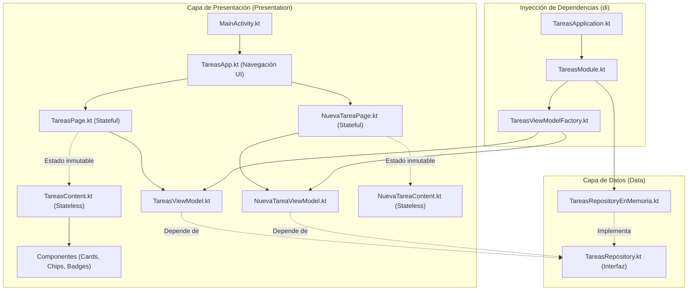
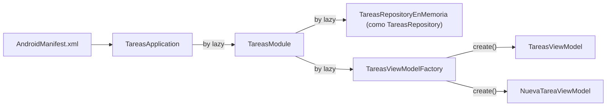
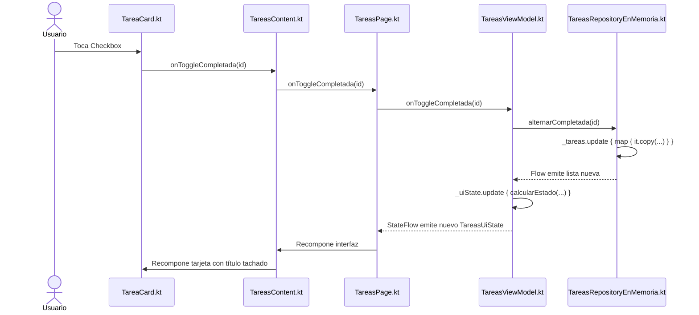

# Guía Maestra para la Defensa Oral del Proyecto "Tareas Escolares"

> **Materia:** Desarrollo de Aplicaciones Móviles  
> **Estudiante:** 4to Semestre de Ingeniería en TI  
> **Stack:** Android Nativo, Kotlin, Jetpack Compose, Material 3, MVVM, UDF, Patrón Repository, DI Manual.

---

## 1. Resumen Ejecutivo del Proyecto

**Tareas Escolares** es una aplicación móvil nativa diseñada para que los estudiantes organicen sus actividades académicas. Cada tarea cuenta con:
* **Identificador único (`id`):** Asignado automáticamente de forma incremental.
* **Título:** Nombre de la actividad (obligatorio, máx. 60 caracteres).
* **Materia:** Asignatura correspondiente (obligatoria, máx. 40 caracteres).
* **Nivel de Prioridad:** Enum con tres valores (`ALTA`, `MEDIA`, `BAJA`).
* **Fecha Límite:** Cadena en formato estricto `dd/MM/yyyy` que no puede ser anterior al día actual.
* **Estado:** Booleano que indica si la actividad está pendiente (`false`) o completada (`true`).

### Funcionalidades principales:
1. Listado ordenado cronológicamente (ascendente por fecha límite) con desempate por prioridad.
2. Filtrado combinado en tiempo real: por estado (`TODAS`, `PENDIENTES`, `COMPLETADAS`) y opcionalmente por nivel de prioridad.
3. Indicador de progreso dinámico que muestra el avance real sobre la totalidad de tareas guardadas.
4. Formulario de creación con validaciones en caliente y prevención de errores.
5. Acciones inmediatas de alternar estado (marcar/desmarcar con tachado) y eliminación definitiva.

---

## 2. Arquitectura de Software y Patrones de Diseño

La aplicación se estructura en dos capas limpias: **Capa de Datos (Data)** y **Capa de Presentación (Presentation)**.



### Patrones Aplicados:
* **MVVM (Model - View - ViewModel):**
  * **Model:** `Tarea.kt` y `TareasRepository.kt`.
  * **View:** Composables stateless (`TareasContent.kt`, `NuevaTareaContent.kt` y componentes). No tienen lógica de negocio; solo renderizan lo recibido y emiten eventos.
  * **ViewModel:** `TareasViewModel.kt` y `NuevaTareaViewModel.kt`. Alojan el estado y procesan los eventos.
* **UDF (Flujo Unidireccional de Datos):** El estado viaja en un único sentido hacia abajo; los eventos suben mediante funciones lambda.
* **Patrón Repository:** Centraliza la fuente de datos tras una interfaz, abstrayendo si la persistencia es en memoria, DataStore o SQLite.
* **State Hoisting:** Ningún Composable hijo guarda variables mutables de la aplicación.
* **Separación Page vs. Content:** 
  * Las **Pages** son *stateful* (obtienen el ViewModel, observan flujos y orquestan navegación).
  * Los **Contents** son *stateless* (funciones puras independientes de la plataforma, aptas para Previews y pruebas).
* **Factory Pattern:** `TareasViewModelFactory.kt` permite a Android instanciar ViewModels con dependencias en su constructor.
* **Fuente Única de Verdad (Single Source of Truth):** El repositorio es el único poseedor de la lista de tareas; los ViewModels no alteran los datos localmente sin que pasen por el flujo del repositorio.

---

## 3. Jerarquía y Estructura de Carpetas

Package base: `com.example.appinteractiva`

```text
com/example/appinteractiva/
├── MainActivity.kt                      -> Punto de entrada de la actividad (arranque sin lógica)
├── TareasApplication.kt                 -> Contenedor global que vive todo el proceso
├── ui/theme/                            -> Sistema de diseño visual
│   ├── Color.kt                         -> Paleta azul y colores de prioridad
│   ├── Theme.kt                         -> LightColorScheme y TareasEscolaresTheme
│   └── Type.kt                          -> Escala tipográfica oficial Material 3
└── tareas/                              -> Módulo temático de tareas
    ├── data/
    │   ├── model/                       -> Clases que modelan los datos del negocio
    │   │   ├── Tarea.kt                 -> Data class inmutable
    │   │   ├── Prioridad.kt             -> Enum ALTA, MEDIA, BAJA
    │   │   └── FiltroEstado.kt          -> Enum TODAS, PENDIENTES, COMPLETADAS
    │   └── repository/                  -> Contratos e implementación de persistencia
    │       ├── TareasRepository.kt      -> Interfaz (Contrato abstracto)
    │       └── TareasRepositoryEnMemoria.kt -> Implementación reactiva con StateFlow
    ├── di/
    │   └── TareasModule.kt              -> Contenedor de inyección manual de dependencias
    ├── util/
    │   └── FechaUtil.kt                 -> Utilidad pura para parseo y validación de fechas
    └── presentation/
        ├── navigation/
        │   ├── Pantalla.kt              -> Destinos de navegación (LISTA, FORMULARIO)
        │   └── TareasApp.kt             -> Enrutador raíz con rememberSaveable
        ├── screens/
        │   ├── TareasUiState.kt         -> Estado inmutable de la lista
        │   ├── FormularioUiState.kt     -> Estado inmutable del formulario
        │   ├── TareasContent.kt         -> UI sin estado de la lista
        │   ├── TareasPage.kt            -> UI con estado conectada a TareasViewModel
        │   ├── NuevaTareaContent.kt     -> UI sin estado del formulario
        │   └── NuevaTareaPage.kt        -> UI con estado conectada a NuevaTareaViewModel
        ├── viewmodels/
        │   ├── TareasViewModel.kt       -> Orquesta filtros, ordenamiento y progreso
        │   ├── NuevaTareaViewModel.kt   -> Orquesta validaciones y creación
        │   └── TareasViewModelFactory.kt-> Fábrica que inyecta el repositorio
        ├── components/                  -> Componentes visuales atómicos reutilizables
        │   ├── ChipOpcion.kt            -> FilterChip reutilizable parametrizado
        │   ├── PrioridadEtiqueta.kt     -> Extensión para vincular prioridad con strings.xml
        │   ├── PrioridadBadge.kt        -> Insignia coloreada de prioridad
        │   ├── PrioridadChips.kt        -> Selector horizontal de prioridad
        │   ├── ProgresoCard.kt          -> Tarjeta con barra LinearProgressIndicator
        │   ├── FiltrosRow.kt            -> Doble fila de filtros
        │   ├── TareaCard.kt             -> Tarjeta individual de tarea
        │   └── EstadoVacio.kt           -> Vista centrada cuando la lista está vacía
        └── preview/
            └── DatosEjemplo.kt          -> Datos ficticios aislados para Android Studio
```

---

## 4. Inyección de Dependencias Manual Paso a Paso

### 4.1 ¿Por qué es necesaria?
`TareasViewModel` y `NuevaTareaViewModel` requieren en su constructor una instancia de `TareasRepository`. En Jetpack Compose, los ViewModels no se crean directamente (`TareasViewModel(...)`), sino mediante la función `viewModel()`, que por defecto solo soporta constructores vacíos. Si no proveemos una fábrica personalizada, la aplicación arrojará una excepción en tiempo de ejecución.

### 4.2 La Cadena de Objetos



#### Paso 1: Inicialización en `TareasApplication.kt`
Al declararse en `AndroidManifest.xml` (`android:name=".TareasApplication"`), el sistema operativo Android garantiza que esta clase exista durante toda la vida del proceso:
```kotlin
class TareasApplication : Application() {
    val tareasModule: TareasModule by lazy {
        TareasModule(applicationContext)
    }
}
```

#### Paso 2: El Contenedor en `TareasModule.kt`
Define y expone las dependencias aplicando el **Principio de Inversión de Dependencias (DIP)**:
```kotlin
class TareasModule(@Suppress("unused") private val context: Context) {
    // Se declara con el tipo de la INTERFAZ para no acoplar la arquitectura a la memoria
    val repository: TareasRepository by lazy {
        TareasRepositoryEnMemoria()
    }

    val factory: TareasViewModelFactory by lazy {
        TareasViewModelFactory(repository)
    }
}
```

#### Paso 3: La Fábrica en `TareasViewModelFactory.kt`
Enseña a Compose cómo instanciar cada ViewModel pasándole el repositorio compartido:
```kotlin
class TareasViewModelFactory(
    private val repository: TareasRepository
) : ViewModelProvider.Factory {

    @Suppress("UNCHECKED_CAST")
    override fun <T : ViewModel> create(modelClass: Class<T>): T {
        return when {
            modelClass.isAssignableFrom(TareasViewModel::class.java) -> {
                TareasViewModel(repository) as T
            }
            modelClass.isAssignableFrom(NuevaTareaViewModel::class.java) -> {
                NuevaTareaViewModel(repository) as T
            }
            else -> throw IllegalArgumentException("Clase desconocida: ${modelClass.name}")
        }
    }
}
```

#### Paso 4: Consumo en las Pages (`TareasPage.kt`)
```kotlin
val application = LocalContext.current.applicationContext as TareasApplication
val viewModel: TareasViewModel = viewModel(factory = application.tareasModule.factory)
val uiState by viewModel.uiState.collectAsStateWithLifecycle()
```
* `LocalContext.current.applicationContext as TareasApplication`: Extrae el singleton global de la aplicación.
* `viewModel(factory = ...)`: Solicita a Android el ViewModel existente o instruye a la fábrica para crearlo si es la primera vez.

---

## 5. Análisis Detallado del Código

### 5.1 Capa de Datos: `TareasRepositoryEnMemoria.kt`
Garantiza inmutabilidad y seguridad ante concurrencia mediante `MutableStateFlow` y `update`:

```kotlin
class TareasRepositoryEnMemoria : TareasRepository {
    // Inicia con lista vacía para que el usuario ingrese sus tareas desde cero
    private val _tareas = MutableStateFlow<List<Tarea>>(emptyList())
    override val tareas: Flow<List<Tarea>> = _tareas.asStateFlow()

    override suspend fun agregarTarea(
        titulo: String,
        materia: String,
        prioridad: Prioridad,
        fechaLimite: String
    ) {
        _tareas.update { listaActual ->
            // RN-06: ID autoincremental seguro
            val nuevoId = (listaActual.maxOfOrNull { it.id } ?: 0) + 1
            val nuevaTarea = Tarea(
                id = nuevoId,
                titulo = titulo,
                materia = materia,
                prioridad = prioridad,
                fechaLimite = fechaLimite,
                completada = false // RN-05: Siempre inicia pendiente
            )
            listaActual + nuevaTarea // Nueva lista inmutable
        }
    }

    override suspend fun alternarCompletada(id: Int) {
        _tareas.update { listaActual ->
            listaActual.map { tarea ->
                if (tarea.id == id) {
                    tarea.copy(completada = !tarea.completada) // Inmutabilidad
                } else {
                    tarea
                }
            }
        }
    }

    override suspend fun eliminarTarea(id: Int) {
        _tareas.update { listaActual ->
            listaActual.filter { it.id != id }
        }
    }
}
```

### 5.2 Capa de Presentación: `TareasViewModel.kt`
Aplica **Backing Property** y calcula el estado en una función pura:

```kotlin
class TareasViewModel(private val repository: TareasRepository) : ViewModel() {

    private val _uiState = MutableStateFlow(TareasUiState(estaCargando = true))
    val uiState: StateFlow<TareasUiState> = _uiState.asStateFlow()

    private var todasLasTareas: List<Tarea> = emptyList()
    private var filtroEstadoActual: FiltroEstado = FiltroEstado.TODAS
    private var filtroPrioridadActual: Prioridad? = null

    init {
        viewModelScope.launch {
            repository.tareas.collect { tareasEmitidas ->
                todasLasTareas = tareasEmitidas
                _uiState.update { estadoActual ->
                    calcularEstado(estadoActual, todasLasTareas, filtroEstadoActual, filtroPrioridadActual)
                }
            }
        }
    }

    private fun calcularEstado(
        estadoBase: TareasUiState,
        tareasCompletas: List<Tarea>,
        filtroEstado: FiltroEstado,
        filtroPrioridad: Prioridad?
    ): TareasUiState {
        // RN-12: Progreso calculado sobre TODAS las tareas guardadas
        val total = tareasCompletas.size
        val completadas = tareasCompletas.count { it.completada }
        val progreso = if (total > 0) completadas.toFloat() / total else 0f

        // RN-11: Ordenamiento ascendente por fecha y desempate por prioridad
        val comparador = Comparator<Tarea> { t1, t2 ->
            val f1 = FechaUtil.parsearFecha(t1.fechaLimite)
            val f2 = FechaUtil.parsearFecha(t2.fechaLimite)
            when {
                f1 == null && f2 == null -> 0
                f1 == null -> 1
                f2 == null -> -1
                else -> f1.compareTo(f2)
            }
        }.thenBy { tarea ->
            when (tarea.prioridad) {
                Prioridad.ALTA -> 0
                Prioridad.MEDIA -> 1
                Prioridad.BAJA -> 2
            }
        }

        // RN-10: Combinación de filtros (Estado Y Prioridad)
        val tareasFiltradas = tareasCompletas
            .filter { tarea ->
                val coincideEstado = when (filtroEstado) {
                    FiltroEstado.TODAS -> true
                    FiltroEstado.PENDIENTES -> !tarea.completada
                    FiltroEstado.COMPLETADAS -> tarea.completada
                }
                val coincidePrioridad = filtroPrioridad == null || tarea.prioridad == filtroPrioridad
                coincideEstado && coincidePrioridad
            }
            .sortedWith(comparador)

        return estadoBase.copy(
            tareas = tareasFiltradas,
            filtroEstado = filtroEstado,
            filtroPrioridad = filtroPrioridad,
            totalTareas = total,
            tareasCompletadas = completadas,
            porcentajeProgreso = progreso,
            estaCargando = false
        )
    }
}
```

### 5.3 Capa de Presentación: `NuevaTareaViewModel.kt`
Gestiona validaciones desacopladas de Android Context mediante identificadores numéricos `@StringRes`:

```kotlin
fun onGuardarClick() {
    val estadoActual = _uiState.value
    val tituloTrim = estadoActual.titulo.trim()
    val materiaTrim = estadoActual.materia.trim()
    val fechaTrim = estadoActual.fechaLimite.trim()

    val errorTitulo = validarTitulo(tituloTrim)
    val errorMateria = validarMateria(materiaTrim)
    val errorFecha = validarFecha(fechaTrim)

    val hayErrores = errorTitulo != null || errorMateria != null || errorFecha != null

    if (hayErrores) {
        // RN-15: Conserva los textos y emite los errores correspondientes
        _uiState.update {
            it.copy(
                errorTitulo = errorTitulo,
                errorMateria = errorMateria,
                errorFecha = errorFecha
            )
        }
    } else {
        viewModelScope.launch {
            repository.agregarTarea(tituloTrim, materiaTrim, estadoActual.prioridad, fechaTrim)
            _uiState.update { it.copy(guardadoExitoso = true) }
        }
    }
}
```

### 5.4 Utilidad de Fechas: `FechaUtil.kt`
Parseo estricto con expresión regular y `SimpleDateFormat(..., Locale.getDefault())` con `isLenient = false`:

```kotlin
object FechaUtil {
    private val regexFormatoFecha = Regex("^\\d{2}/\\d{2}/\\d{4}$")

    fun parsearFecha(texto: String): Date? {
        if (!regexFormatoFecha.matches(texto)) return null

        val formato = SimpleDateFormat("dd/MM/yyyy", Locale.getDefault()).apply {
            isLenient = false // Rechaza fechas como 31/02/2026
        }

        return try {
            formato.parse(texto)
        } catch (e: ParseException) {
            null
        }
    }

    fun esAnteriorAHoy(fecha: Date): Boolean {
        val hoyMedianoche = Calendar.getInstance().apply {
            set(Calendar.HOUR_OF_DAY, 0)
            set(Calendar.MINUTE, 0)
            set(Calendar.SECOND, 0)
            set(Calendar.MILLISECOND, 0)
        }
        return fecha.before(hoyMedianoche.time)
    }
}
```

---

## 6. Flujos UDF Paso a Paso

### 6.1 Flujo: "Marcar o desmarcar tarea completada"



1. **Evento en la UI:** El usuario toca el `Checkbox` en `TareaCard.kt`, disparando la lambda `onToggleCompletada(tarea.id)`.
2. **Elevación de Estado (State Hoisting):** La llamada pasa por `TareasContent.kt` y llega a `TareasPage.kt`, que delega a `viewModel::onToggleCompletada`.
3. **Petición asíncrona:** En `TareasViewModel.kt`, se lanza una corrutina con `viewModelScope.launch { repository.alternarCompletada(id) }`.
4. **Modificación inmutable en Repositorio:** `TareasRepositoryEnMemoria.kt` genera una nueva lista donde la tarea objetivo es reemplazada por `it.copy(completada = !it.completada)`.
5. **Emisión Reactiva del Flow:** El repositorio emite la lista actualizada.
6. **Recálculo de Negocio:** El bloque `init` del ViewModel recibe la lista y ejecuta `_uiState.update { calcularEstado(...) }`, recalculando métricas de progreso y orden.
7. **Recomposición en Compose:** `TareasPage.kt` observa `uiState` mediante `collectAsStateWithLifecycle()` y redibuja la pantalla con el checkbox marcado, el título tachado y la barra de progreso actualizada.

---

## 7. Cumplimiento de Principios SOLID

| Principio | Aplicación en el Proyecto |
| :--- | :--- |
| **S (Single Responsibility)** | Cada clase tiene un único rol: `FechaUtil` solo parsea fechas; `TareasRepositoryEnMemoria` solo almacena tareas; `TareasViewModel` solo orquesta la lista; `TareasContent` solo dibuja la pantalla. |
| **O (Open/Closed)** | El sistema está abierto a la extensión y cerrado a la modificación: podemos agregar persistencia con `DataStore` creando una nueva clase que implemente `TareasRepository` sin tocar una sola línea de los ViewModels. |
| **L (Liskov Substitution)** | Cualquier implementación de `TareasRepository` (en memoria, Room o DataStore) puede sustituirse mutuamente sin alterar el funcionamiento del sistema. |
| **I (Interface Segregation)** | `TareasRepository` solo define los cuatro métodos requeridos por el dominio (`tareas`, `agregarTarea`, `alternarCompletada`, `eliminarTarea`), sin métodos redundantes. |
| **D (Dependency Inversion)** | Los ViewModels dependen de la abstracción (`TareasRepository`), no de la clase concreta `TareasRepositoryEnMemoria`. La dependencia se inyecta desde `TareasModule`. |

---

## 8. Banco de Preguntas Clave para el Examen Oral

### P1. ¿Por qué el estado se modela como data class inmutable?
> **Respuesta:** Para que cualquier mutación obligue a crear un nuevo objeto mediante `.copy()`. Jetpack Compose compara por referencia (`equals`) el estado anterior con el nuevo para decidir exactamente qué elementos necesitan recomponerse, evitando inconsistencias por memoria compartida.

### P2. ¿Por qué usamos `collectAsStateWithLifecycle()` en lugar de `collectAsState()`?
> **Respuesta:** Porque respeta el ciclo de vida de Android. Si la aplicación pasa a segundo plano o la pantalla no está visible, detiene automáticamente la recolección del flujo, liberando CPU y batería.

### P3. ¿Por qué los errores del formulario son `@get:StringRes Int?` y no `String`?
> **Respuesta:** Para desacoplar el ViewModel del `Context` de Android. El ViewModel solo manipula identificadores numéricos de recursos (`R.string.error_...`), delegando a la vista la traducción mediante `stringResource()`.

### P4. ¿Por qué `pantallaActual` vive en `TareasApp` con `rememberSaveable` y no en un ViewModel?
> **Respuesta:** Porque la pantalla actual es estado efímero de navegación de la interfaz, no un dato de la lógica de negocio. `rememberSaveable` permite que la pantalla seleccionada sobreviva a cambios de configuración (como la rotación del dispositivo) sin sobrecargar la capa de negocio.

### P5. ¿Qué hace `_tareas.update { ... }` en el repositorio?
> **Respuesta:** Ejecuta una operación atómica y segura para hilos (*thread-safe*). Si varias corrutinas intentan modificar las tareas concurrentemente, `update` garantiza que ninguna mutación se sobrescriba ni se pierda.

---

## 9. Guía de Modificaciones Exprés en Vivo

Si el profesor te solicita realizar un cambio en vivo durante la defensa, estos son los archivos clave a intervenir:

* **Cambiar el límite de caracteres del título (ej. de 60 a 80):**
  1. `NuevaTareaViewModel.kt`: Modificar `titulo.length > 60` por `80`.
  2. `strings.xml`: Actualizar el texto en `error_titulo_demasiado_largo`.
* **Cambiar el color primario de la aplicación:**
  1. `Color.kt`: Modificar el valor hexadecimal de `AzulPrimario`.
* **Invertir el orden de las tareas (de la más lejana a la más próxima):**
  1. `TareasViewModel.kt`: Invertir la comparación a `fecha2.compareTo(fecha1)`.
* **Calcular el progreso solo sobre las tareas visibles (filtradas):**
  1. `TareasViewModel.kt`: Calcular `total` y `completadas` sobre `tareasFiltradas` en lugar de `tareasCompletas`.
* **Agregar una nueva prioridad (ej. `URGENTE`):**
  1. `Prioridad.kt`: Agregar `URGENTE`.
  2. `PrioridadEtiqueta.kt`: Añadir el caso en el `when`.
  3. `strings.xml`: Añadir el string `prioridad_urgente`.
  4. `PrioridadBadge.kt`: Asignar sus colores en el `when`.
  5. `TareasViewModel.kt`: Darle peso `0` en el comparador de desempate.
